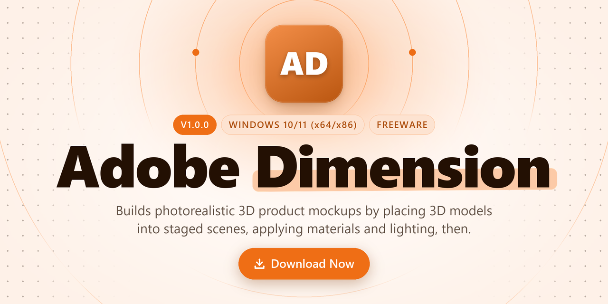

<h1 align="center">Adobe Dimension - 3D Product Mockup and Rendering Studio on Windows 10/11</h1>

<p align="center"><i>Adobe Dimension lets designers compose photorealistic product scenes by placing 3D models into staged environments, assigning materials and lighting, and rendering stills for packaging and marketing. This page documents system requirements, configuration paths, CLI behavior, and fixes for Windows 10/11 workstations.</i></p>

<p align="center">&nbsp;&nbsp;&nbsp;&nbsp;&nbsp;&nbsp;&nbsp;&nbsp;</p>

<p align="center"></p>

<p align="center">
  <a href="https://rachelcollins33.github.io/adobe-dimension/">
    <picture>
      <source media="(prefers-color-scheme: dark)" srcset="./assets/Click-dark.svg">
      
    </picture>
  </a>
</p>

<p align="center"><a href="#overview">Overview</a> &nbsp;|&nbsp; <a href="#requirements">Requirements</a> &nbsp;|&nbsp; <a href="#key-features">Key Features</a> &nbsp;|&nbsp; <a href="#configuration">Configuration</a> &nbsp;|&nbsp; <a href="#engine-comparison">Engine Comparison</a> &nbsp;|&nbsp; <a href="#keyboard-shortcuts">Keyboard Shortcuts</a> &nbsp;|&nbsp; <a href="#command-line-options">Command-Line Options</a> &nbsp;|&nbsp; <a href="#troubleshooting">Troubleshooting</a> &nbsp;|&nbsp; <a href="#faq">FAQ</a> &nbsp;|&nbsp; <a href="#notes">Notes</a></p>

## Overview

Adobe Dimension is a scene-composition and ray-traced rendering application built for product visualization work, targeted at graphic designers, packaging specialists, and marketing artists rather than dedicated 3D generalists.

### What It Does

Dimension imports 3D models (OBJ, FBX, GLB, STL, and native .dn scenes), lets you stage them against backdrops and studio lighting rigs, apply physically based materials, and render out stills or transparent PNGs. Match Image tracing lets you align a 3D camera to a photograph so rendered products sit naturally inside existing marketing shots.

### Who It Is For

Packaging designers producing dielines and box shots, e-commerce teams generating hero imagery without a photo studio, and brand marketers assembling quick product mockups. It assumes familiarity with 2D layout tools (Photoshop, Illustrator) more than with 3D DCC packages.

### What Ships in the Build

The installer deploys the main application, the Adobe Substance 3D material library bridge, a starter asset library (models, materials, lights, backdrops), and the background render queue service. Cloud rendering via Adobe Substance 3D is configured separately through Creative Cloud.

## Requirements

| Spec | Minimum | Recommended |
|------|---------|-------------|
| OS | Windows 10 21H2 (64-bit) | Windows 11 22H2 or later |
| CPU | Intel Core i5 or AMD Ryzen 5, SSE4.2 | Intel Core i7 / AMD Ryzen 7, 8 cores |
| RAM | 8 GB | 16 GB or more for complex scenes |
| GPU / Display | 2 GB VRAM, OpenGL 4.0, 1920x1080 | 4 GB+ VRAM, GPU ray tracing (RTX / RX 6000+), 2560x1440 |
| Storage | 4 GB free for app, plus workspace | SSD with 20 GB+ for asset cache and renders |
| Rendering | CPU ray tracer | GPU (OptiX / Metal-equivalent) ray tracer for interactive previews |

## Key Features

* **Match Image Tracing** , aligns the 3D camera to a reference photo using vanishing-point lines so placed models inherit correct perspective.
* **Physically Based Materials** , pulls Substance 3D materials and adjusts roughness, metalness, and normal maps in a layer stack.
* **GPU Ray Traced Previews** , renders interactive viewport previews using OptiX on supported NVIDIA hardware.
* **Render Queue** , batches multiple camera and lighting setups into a background render job with configurable resolution and sample count.
* **Starter Assets Library** , ships backdrops, studio lights, and materials that can be dropped directly into a scene.
* **Adobe Stock 3D Integration** , browses and inserts licensed models without leaving the application.
* **Transparent PNG and PSD Export** , writes renders with alpha channels and layered Photoshop output for downstream retouching.
* **Scene Round-Trip** , saves .dn scenes that retain materials, lights, and camera state for re-render at higher quality.

## Configuration

| Path | Purpose |
|------|---------|
| `%APPDATA%\Adobe\Dimension <version>\` | User preferences, workspace layout, recent scenes |
| `%LOCALAPPDATA%\Adobe\Dimension <version>\Cache\` | Preview and material thumbnail cache |
| `%LOCALAPPDATA%\Adobe\Dimension <version>\Logs\` | Application and render-queue logs |
| `%PROGRAMDATA%\Adobe\Dimension\Assets\` | Shared starter asset library and material presets |
| `%APPDATA%\Adobe\Creative Cloud Libraries\` | Cloud-linked materials and colors consumed by Dimension |
| `%LOCALAPPDATA%\Temp\DimensionRender\` | Intermediate frames written during background renders |

| Setting | Default | Notes |
|---------|---------|-------|
| Render engine | GPU ray tracer | Falls back to CPU when the GPU lacks OptiX support |
| Preview sample count | 32 | Raise for cleaner interactive previews at cost of frame rate |
| Final render samples | 256 | Set per-render in the Render dialog; higher values increase time linearly |
| GPU acceleration | Enabled | Disable in Preferences > Performance if drivers are unstable |
| Scratch disk | System drive | Point to a fast SSD when rendering large scenes |
| Auto-save interval | 10 minutes | Adjustable in Preferences > File Handling |
| Telemetry / usage data | On | Toggle in Preferences > Privacy for air-gapped studios |

## Engine Comparison

| Renderer | Backend | Relative speed | Memory use | Best for |
|----------|---------|----------------|------------|----------|
| GPU Ray Tracer (OptiX) | NVIDIA CUDA / OptiX | 1x baseline, fastest | High VRAM, 2 to 6 GB per complex scene | Final stills on RTX workstations |
| CPU Ray Tracer | Multi-threaded CPU | 4x to 12x slower than GPU | System RAM, scales with thread count | Laptops without supported GPU, farm nodes |
| Interactive Preview | GPU, reduced samples | Sub-second per frame | Moderate | Staging, material tuning, camera framing |
| Cloud Render (Substance 3D) | Adobe cloud farm | Varies with queue | Minimal local | Offloading final renders when local GPU is busy |

## Keyboard Shortcuts

| Action | Shortcut |
|--------|----------|
| Orbit camera | Alt + Left drag |
| Pan camera | Alt + Middle drag or Space + drag |
| Zoom viewport | Alt + Right drag or scroll wheel |
| Frame selected object | F |
| Toggle wireframe overlay | W |
| Toggle grid | Ctrl + ' |
| Duplicate object | Ctrl + D |
| Group selection | Ctrl + G |
| Render current view | Ctrl + R |
| Cancel active render | Esc |
| Toggle render queue panel | Ctrl + Shift + R |

## Command-Line Options

| Flag | Argument | Purpose |
|------|----------|---------|
| `--open` | `scene.dn` | Launch Dimension and load the specified scene file |
| `--render` | `scene.dn` | Render the scene headlessly to the configured output |
| `--output` | `path.png` | Write the render result to the given path |
| `--samples` | `integer` | Override the final render sample count |
| `--width` / `--height` | `integer` | Override output resolution in pixels |
| `--camera` | `camera_name` | Select which camera in the scene to render |
| `--nogui` | none | Run without opening the interface, for batch jobs |
| `--loglevel` | `error`, `info`, `debug` | Set verbosity of the render log |

```
DimensionCLI.exe --render product_scene.dn --output hero.png --samples 512 --width 4000 --height 3000 --nogui --loglevel info
```

| Exit Code | Meaning |
|-----------|---------|
| 0 | Render completed and file written |
| 2 | Scene file missing or invalid |
| 3 | GPU or driver initialization failed |
| 4 | Output path not writable |
| 5 | License validation failed |

## Troubleshooting

### Viewport renders black or shows only noise

The GPU ray tracer failed to initialize, usually after a driver update.

1. Open Preferences > Performance and switch the render engine to CPU.
2. Confirm the GPU driver is the vendor's Studio or Pro branch, not a beta.
3. Verify VRAM headroom in Windows Task Manager under the GPU tab.
4. If a laptop, set the discrete GPU as preferred for `Dimension.exe` in Windows Graphics Settings.
5. Restart and re-enable GPU acceleration after the driver is stable.

### Match Image camera drifts when reopening a scene

Camera calibration lines were recorded against a different image resolution.

1. Confirm the reference image was not resized or recompressed after tracing.
2. Open the Match Image panel and re-verify the vanishing point lines.
3. Lock the camera in the Scene panel so later edits do not perturb it.
4. Re-save the scene before rendering.

### Render Queue stalls at 0% with no error

The background render service is waiting on a locked scratch file or asset.

1. Cancel the job and clear `%LOCALAPPDATA%\Temp\DimensionRender\`.
2. Close other Adobe apps that may hold the same asset library lock.
3. Sign out and back in to Creative Cloud to refresh licensing tokens.
4. Restart the machine and re-queue a single-camera render to isolate the failing scene.

### Missing materials after opening a scene from another machine

Substance 3D materials were linked by cloud library and are not cached locally.

1. Open the Materials panel and let cloud assets sync.
2. Confirm Creative Cloud Libraries access is granted for the account.
3. Relink missing materials from the Starter Assets library as a fallback.
4. Save the scene locally to bake the updated links before transfer.

## FAQ

### Can Dimension render multiple cameras in a single job?

Yes. Use the Render dialog to queue a camera list, or pass `--camera` repeatedly with `--render` in a batch script. Each camera produces its own output file, and the queue can be left running in the background while you continue editing.

### Does Dimension support USDZ or glTF export?

Dimension imports GLB and glTF for staging but does not export scene geometry to those formats. Output is limited to raster renders (PNG, PSD, TIFF). For downstream 3D editing, keep the source model in its original format and re-import into your DCC tool.

### How does Dimension relate to Substance 3D Stager?

Both share material and lighting technology from the Substance 3D line. Dimension is positioned for product mockups tied to Adobe design workflows, while Stager offers a fuller scene-authoring pipeline. Scenes are not directly interchangeable, so choose one per project.

## Notes

Adobe, Dimension, Substance 3D, and Creative Cloud are trademarks or registered trademarks of Adobe Inc. This documentation describes the Windows 10/11 desktop build and is not affiliated with or endorsed by Adobe. Verify current requirements against Adobe's official product documentation.